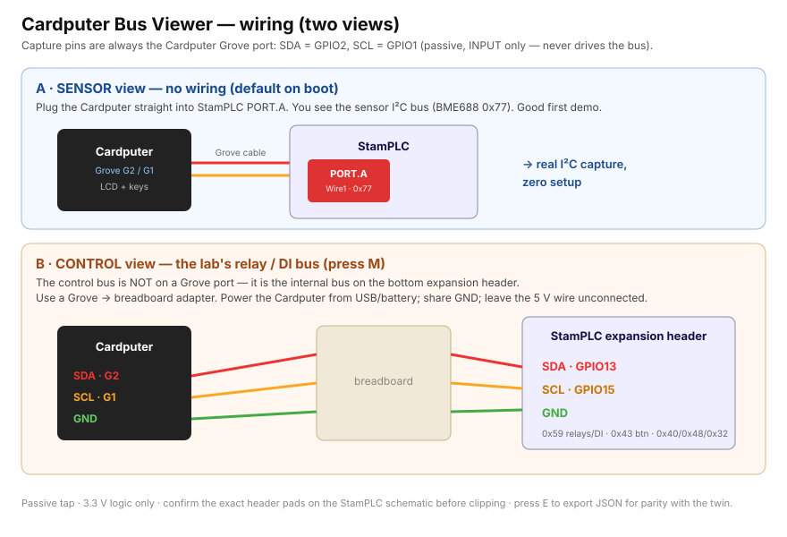

# Cardputer I2C Bus Viewer — a handheld analyzer for the StamPLC bus

A complementary, self-contained signal analyzer for the Week-10 bus lab: an M5Stack
Cardputer that passively sniffs I2C and shows the decoded transactions on its own LCD.
It's the FX2 + laptop tap collapsed into one handheld — the third tier alongside the
virtual `i2c-analyzer.html` (the QEMU twin) and the bench FX2 + PulseView, all sharing
the same sigrok-style I2C decode and the same `parity_test.py`.

## Flash it (no build needed)
Prebuilt image in [`prebuilt/`](prebuilt/):
- **One file, esptool:** `esptool --chip esp32s3 write_flash 0x0 prebuilt/cardputer-analyzer-8MB.bin`
- **Browser (Chrome/Edge WebSerial):** M5Burner, or an ESP Web Tools button on the factory bin.
- **Verify:** `sha256sum -c prebuilt/SHA256SUMS.txt`
- **Rebuild instead:** `pio run -e cardputer` (first build pulls the ESP32-S3 toolchain once).

## Wire it — two views, same capture pins

The Cardputer always sniffs its **Grove port: SDA = GPIO2, SCL = GPIO1** (passive, INPUT
only — it cannot disturb the bus). Where you connect those two lines picks the view:

- **SENSOR view (zero wiring — the default on boot):** plug the Cardputer straight into the
  StamPLC **PORT.A** Grove jack. You see the sensor I2C bus (BME688 `0x77`). Good first demo.
- **CONTROL view (the lab's relay/DI bus):** that bus is *not* on any Grove port — it is the
  internal `In_I2C` on the bottom **expansion header** (SDA = **GPIO13**, SCL = **GPIO15**, GND).
  Use a **Grove → breadboard** adapter: Cardputer SDA (G2) → header GPIO13, SCL (G1) → header
  GPIO15, and a **common GND**. Press **M** to switch to CONTROL. You then see `0x59`
  (relays / opto-DI), `0x43` (buttons), `0x40 / 0x48 / 0x32`. Power the Cardputer from its own
  USB/battery; don't tie the Grove 5 V line. (Confirm the exact header pads on the StamPLC
  schematic first.)

## Keys
`M` mode (SENSOR ⇄ CONTROL) · `P` pause/run · `C` clear · `E` export (prints the captured
transactions as JSON over USB serial @ 115200).

## Connect to the virtual lab
Press **E** to dump the capture as JSON (`cardputer.i2c-capture/v1`) over USB. Feed it to
`i2c-analyzer.html` or `parity_test.py` to confirm the handheld's *real* capture decodes to
the same transactions the QEMU twin *reconstructs* — the parity pair, on a screen you can
hold up next to the virtual view.

## Honest limits
Passive software sniffer tuned for the StamPLC's **bursty 400 kHz** bus; a continuously
saturated bus can drop events (shown as `drop:` on screen). 3.3 V logic only. The on-device
decode is a teaching view, not a bench Saleae. **Bench-validate on real hardware** — the
firmware is compile-verified here; timing and the LCD render are confirmed on the device.
