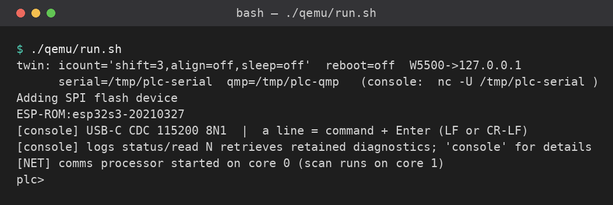
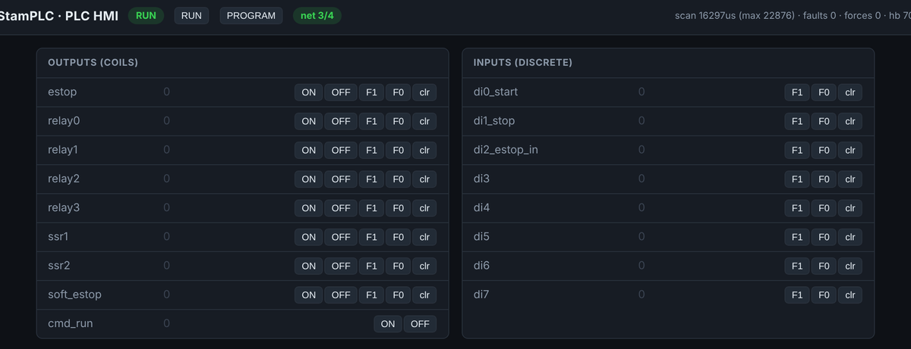
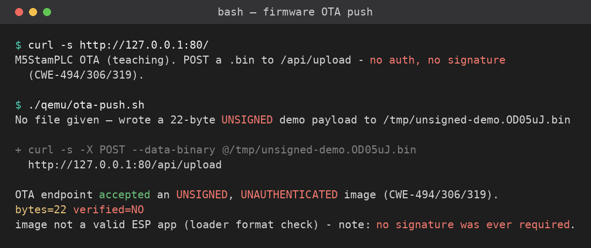

# Part 6 — Firmware & the Unsigned Update

Parts 1–5 read what a device is *made of* and watched one bus exchange. Now you run the
**real firmware** — the same image that boots on the physical TBD controller — on an emulator,
and you find a vulnerability that no SBOM or bus capture from the earlier parts could
have shown you on its own: an **unsigned over-the-air (OTA) update** path.

> **No hardware, no device network.** The twin is a patched build of Espressif's QEMU
> that boots the *unmodified* firmware. Everything below runs inside your Codespace (or
> local Dev Container) — the same `plc>` console, the same Modbus/HMI/OTA services you'd
> meet on the bench.

Tools (set up for you by the dev container): the **QEMU twin** (`qemu/run.sh`), **curl**,
**python3** with `pymodbus`, and **nc** (netcat).

---

## Before you start — boot the twin

The dev container already fetched the twin for your platform (x86-64 in Codespaces,
arm64 if you're local on an Apple-silicon Mac). If you skipped that, fetch it now:

```bash
./qemu/fetch-qemu.sh          # one-time: downloads the binary + 8 MB image for your arch
```

Start the firmware. Leave this running in its own terminal:

```bash
./qemu/run.sh                 # boots to a plc> prompt; serial on /tmp/plc-serial
```



In a **second** terminal, attach to the console and the services:

```bash
./qemu/console.sh             # the live plc> console  (quit: Ctrl-C, or close the pane)
```

> **Don't like wrappers?** Every helper script just runs one plain command and
> prints it first, so you always see exactly what ran. `./qemu/console.sh` is
> simply `nc -U /tmp/plc-serial`. Open any `*.sh` here to read it annotated.

---

## Exercise 1 — meet the device, and its attack surface

At the `plc>` prompt, run the firmware's own self-report:

```
plc> cwe          # the intentional weaknesses this image ships with
plc> proto        # the selectable services, their ports, and attack surface
```

The HMI is served over the emulated W5500 on port **8080**. In Codespaces, VS Code
forwards it automatically — open the **Ports** tab and click the globe on port `8080`
(locally, browse to `http://127.0.0.1:8080`).



**Do:** from the HMI and the `cwe`/`proto` output, list the services that answer **by
default** and the port each uses. Note which of them require any authentication to issue
a command. (You met one of these as an *unauthenticated Modbus write* in Part 3 — find it
again here, now with the whole device around it.)

---

## Exercise 2 — the unsigned update

The firmware exposes a firmware-update endpoint on port **80**. Ask it what it is:

```bash
curl -s http://127.0.0.1:80/                       # the endpoint advertises itself
```

### Active learning

- **Predict** — write down, *before* you push: will the server **accept** a 22-byte
  unsigned blob that is obviously not a real image? If it reports `verified=NO`, does
  `NO` mean the upload was *rejected*, or that it was *stored without being verified*?
- **Run** — `./firmware-ota/push-unsigned.sh   # POST the 22-byte unsigned blob`
- **Reconcile** — the response states the bytes **accepted** plus `verified=NO`. That
  establishes the write was *unauthenticated and unsigned* (an observation). It does
  **not** establish that this particular blob would *boot* — the 2nd-stage loader
  format-checks it, so 22 bytes won't run. "Accepted 22 bytes" is the observation; "a
  well-formed malicious image would boot" is the inference.
- **Pair check** — tell a partner, in one sentence, why `verified=NO` is worse than a
  rejection, not better.



<!-- SHOT: part 6 — push-unsigned.sh output showing bytes accepted + verified=NO -->

Read the response carefully. The firmware **accepted** an unauthenticated, unsigned
upload and reports `verified=NO`. The 2nd-stage loader still *format-checks* the image
(so a 22-byte string isn't bootable), but that is not a security control — **no signature,
no authentication, no TLS** gated the write.

**Do:** record the endpoint, the method, and the exact words of the response. Then name
every weakness class you can justify **from what you observed in this exchange**:

| Observed in the OTA POST | CWE |
|---|---|
| The upload needed no credential | CWE-306 Missing authentication |
| It was sent as cleartext HTTP | CWE-319 Cleartext transmission |
| No signature/hash was checked | CWE-494 Download of code without integrity check |

CWE-22 (path traversal) is **not** established by this upload — the OTA log path is built
from the client's numeric IP, which can't contain `../`. The weakness lives elsewhere: the
HMI **log viewer** builds a file path straight from your input with no sanitization. The
sanitizer is switched off by a build flag, and the path is then concatenated raw:

- **Define:** `sbom/firmware/src/config.h:133` — `#define LOG_VIEWER_PATH_SANITIZE 0`
- **Bad build:** `sbom/firmware/src/web_hmi.cpp:86` — `String filepath = String(LOG_DIR) + "/" + filename;`
  (`LOG_DIR` is `"/logs"`; `filename` comes straight from `?file=`, so `../` is kept verbatim)

You can read those two lines in the source, and watch the device accept an un-sanitized
traversal path:

```bash
./firmware-ota/show-log-traversal.sh   # GET /logs?file=../../config.txt (un-sanitized path)
```

On the twin this returns *File not found* — the emulated log store is empty, so there is
nothing outside `/logs` to exfiltrate. That is the teaching point, not a let-down: the
**source** proves the weakness class (no path sanitization), your **runtime observation**
here does **not** establish that data actually leaks, and a populated device is where that
inference would be tested. Separating "the code is vulnerable" from "I exfiltrated a file"
is exactly the habit the lab grades.

---

## Exercise 3 — static meets dynamic (the whole point)

You proved the behavior at runtime. Now find it in the code, so you can say *why* it
happens — and argue what each view could and could not tell you.

The firmware source is in the SBOM part you already have (`sbom/firmware/`). Open the
OTA handler and read the "verification" step:

```bash
./firmware-ota/show-bug.sh   # grep the OTA source for the verification step
```

You'll find a `verify_firmware()` that returns a constant — it never checks a signature
or hash. That single line is the vulnerability; the runtime `verified=NO` is its
consequence.

**Do:** quote the deciding lines (file + line number). Then answer, in two sentences:
what could the **static** read *not* tell you that the **dynamic** test did, and what
could the dynamic test *not* tell you that the static read did? (Hint: reachability vs.
the exact code path.)

---

## The lesson: signing is the missing control

An unsigned OTA means the firmware running on the device can't be trusted to be the
firmware anyone reviewed. Whoever controls the update **source** controls the device —
without ever touching it. The fixes are specific, and you'll specify them in the
assignment:

- **Secure Boot v2** — the chip refuses an image it can't verify against a provisioned key.
- **Signed OTA** — the update server's images are signed; the device checks the signature
  before flashing.
- **Signed SBOM attestation** (SLSA / in-toto) — so the running image can be tied back to
  the exact source and dependency set you vetted in Part 5.

Part 7 shows what an attacker does with this primitive when it's left open.

---

## Your finding (what you hand in for Part 6)

One short finding, same standard as every part: **what the evidence shows, what it does
*not* establish, your uncertainty, and the next observation that would decide a competing
explanation.** Concretely:

1. The OTA endpoint, method, and the acceptance response (your Exercise 2 evidence).
2. The CWE table, with one sentence justifying each from what you *observed* (not assumed).
3. The quoted verification code (Exercise 3) and your static-vs-dynamic argument.
4. One sentence: which single control from "the lesson" you would add first, and why.

> Remember the habit from Part 3: separate **what you observed** from **what you inferred**.
> "The endpoint returned `verified=NO`" is an observation; "the device would boot a
> malicious image" is an inference — a correct one, but say which is which.
