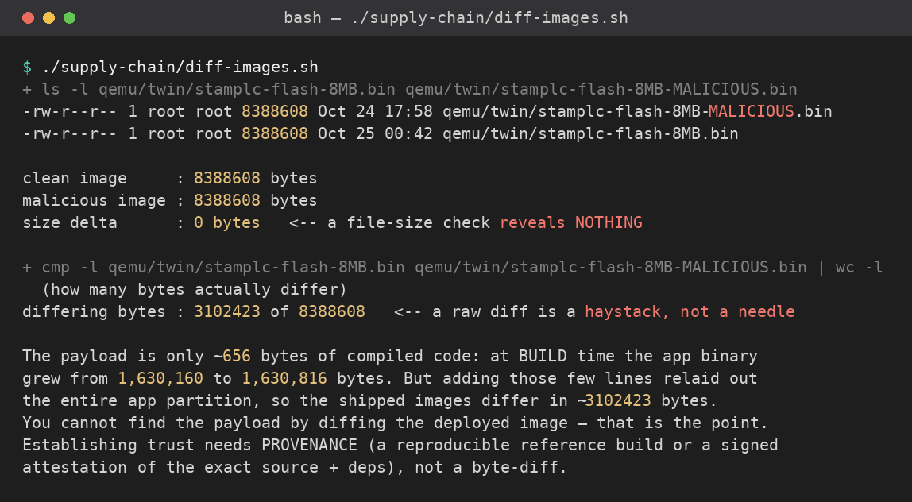
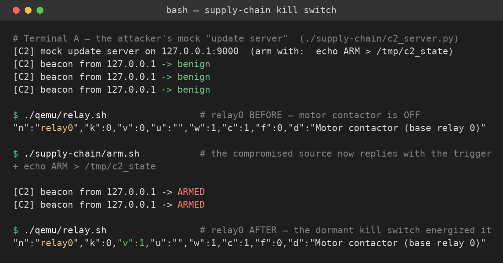

# Part 7 — The Supply-Chain Kill Switch

Part 6 left a door open: an **unsigned OTA** the firmware accepts from anyone. This part
shows what an attacker does with that door — and it is not what most people expect. The
malicious firmware is **almost identical** to the real one. The difference is a few
dormant bytes that wait for a signal and then move a relay.

You will run both images, measure the difference, and detonate the switch in the twin.

> **Teaching artifact.** The malicious image is built from the *same source* as the
> legitimate one, with one compile flag turned on. Nothing here leaves your container.

Tools (set up for you): the **twin** with **both** images, **python3**, and the mock C2
"update server" in [`c2_server.py`](c2_server.py).

---

## Before you start

The dev container fetched **two** images. Confirm both are present:

```bash
ls -l qemu/twin/stamplc-flash-8MB*.bin
```

You should see the legitimate `stamplc-flash-8MB.bin` and `stamplc-flash-8MB-MALICIOUS.bin`.
(If the malicious one is missing, re-run `./qemu/fetch-qemu.sh`.)

---

## Exercise 1 — the minimal diff

An attacker who can replace the update wants the smallest, quietest change that works.
Measure it.

### Active learning

- **Predict** — write down, *before* you run it: the compiled payload is ~**624 bytes**.
  Roughly how many of the 8,388,608 bytes in the shipped image do you expect to **differ**
  between the clean and malicious builds — hundreds, or millions? And: could a byte-diff of
  the deployed image, with no trusted reference, pin down the 624-byte payload?
- **Run** — `./supply-chain/diff-images.sh   # same-size check + how many bytes differ`
- **Reconcile** — the two images are the **same size** (file-size check: 0 delta) and
  **millions** of bytes differ, because adding a few source lines relaid out the whole app
  partition. So diffing alone **cannot** isolate the ~624-byte payload — the differing-byte
  count is the observation; "the diff would reveal the payload" is an inference it *refutes*.
  Provenance (a reproducible reference build or signed attestation) beats diffing here.
- **Pair check** — tell a partner what you *would* need to find the payload, given the diff.



<!-- SHOT: part 7 — diff-images.sh output: 0 size delta, millions of differing bytes -->


Here's the twist, and it's the whole lesson: the two flash images are the **same size**
(both padded to 8 MB), and a naive byte-diff shows **millions** of differing bytes —
because adding a few lines of code relaid out the entire app partition. The real payload
is tiny: at build time the compiled app binary grew by only **624 bytes** (a dormant
beacon plus a one-line relay force). But that 624 is a *build fact* — you cannot see it
by diffing the shipped image.

**Do:** run `./supply-chain/diff-images.sh` and record the size delta (0 — a file-size
check tells you nothing) and the differing-byte count. Then answer in one sentence: if a
naive diff of the deployed image is a haystack, what *would* let you establish that the
running image is the one you reviewed? (This is the provenance problem from the pre-read:
a reproducible reference build or a signed attestation — not a byte-diff.)

---

## Exercise 2 — detonate it

**Terminal A — the attacker's update server** (starts benign):

```bash
python3 supply-chain/c2_server.py        # mock "update check" server on :9000
```

**Terminal B — the victim PLC**, running the malicious image at full speed:

```bash
./supply-chain/run-malicious.sh   # boot the TROJANED image in the twin (full-speed clock)
```

Watch Terminal A. The device **beacons outbound** to the update server every few seconds.
While the server answers normally, the switch stays dormant:

```
[C2] beacon from 127.0.0.1 -> benign
```

Now play the attacker: flip the server's answer.

```bash
./supply-chain/arm.sh      # the compromised source now replies with the trigger
```

> `./supply-chain/benign.sh` resets the server's reply. Note that `benign.sh` only changes
> what the *server* sends — once the switch has fired, `relay0` stays **latched in the
> running image until you reboot the twin**. To re-run the detonation cleanly, stop
> Terminal B and `./supply-chain/run-malicious.sh` again.

The next beacon arms the switch:

```
[C2] beacon from 127.0.0.1 -> ARMED
```



Confirm the physical effect — on the HMI (`:8080`) `relay0` is now ON, and:

```bash
./supply-chain/show-relay.sh   # read relay0 back from the HMI ("v":1 = energized)
```

> `./supply-chain/show-relay.sh relay2` reads a different point. (It delegates to the
> canonical `./qemu/relay.sh`, so there is one source of truth for the readback.)

**Do:** capture the C2 log (benign → ARMED) and `relay0` before and after you armed it.
Then write, as a **graded sentence** in your finding: *"nothing inbound; it rode the
outbound update check."* The trigger rode the device's own outbound "update check," which
no inbound firewall rule would see — **nothing connected inbound at all**.

---

## Exercise 3 — the bus, and the four lenses

The relay actuation is the same `0x59` write you decoded in Part 3. If you want the
bus-level proof, capture and decode it with the Part-3 tooling while the switch fires
(see [`bus-analysis/`](../bus-analysis/)); you'll see the AW9523 write go `data 0 → 1`.

**Do:** in a short paragraph, place this one attack on the four analysis lenses from the
pre-read, and say which tool would catch it and which would miss it:

| Lens | What it sees here | Catches the switch? |
|---|---|---|
| Source SAST | the dormant trigger is a few guarded lines | yes, *if* you have the source |
| Binary decompile | a 624-byte delta in a 1.6 MB image | only with a trusted reference to diff |
| QEMU memory + bus | the `0x59` write the instant it fires | yes — the outcome |
| Active / OTA | the beacon + the magic reply | yes — the trigger |

---

## The lesson: owning the source is owning the fleet

When nothing is signed, an attacker never has to touch your devices — compromising the
**update source** is enough, and the payload can be tiny and dormant. The controls that
break *every* link in this chain are the same ones from Part 6:

- **Secure Boot v2** — the malicious image never boots (no valid signature).
- **Signed OTA** — the device rejects the unsigned update before flashing.
- **Signed SBOM attestation** (SLSA / in-toto) — you can prove the running image is the
  one whose source and dependencies you reviewed, so a swapped source is detectable.

Reproducible builds close the last gap: with a trusted reference image, the 624-byte diff
is trivial to find.

Those controls are not hypothetical here: the **hardened `m5stamplc_secure` build**
refuses the unsigned OTA that Part 6 pushed, so this kill switch never reaches the device.
You'll run exactly these attacks against that build and watch them fail in **Part 9**.

---

## Your finding (what you hand in for Part 7)

One finding, same standard:

1. The image sizes and delta (Exercise 1), and your answer on finding the diff without a reference.
2. The detonation evidence: the C2 log (benign → ARMED) and `relay0` before/after (Exercise 2),
   **including the graded sentence** *"nothing inbound; it rode the outbound update check."*
3. The four-lens table (Exercise 3), with one sentence on which lens you trust most for *this* attack and why.
4. One sentence: the single control you would mandate before shipping this device, and the attack step it stops.

> Keep separating observation from inference. "`relay0` read `1` after I armed the C2" is
> an observation; "an operator would see a pump energize" is the inference that makes it
> matter — say which is which.
