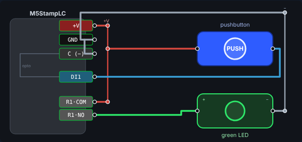
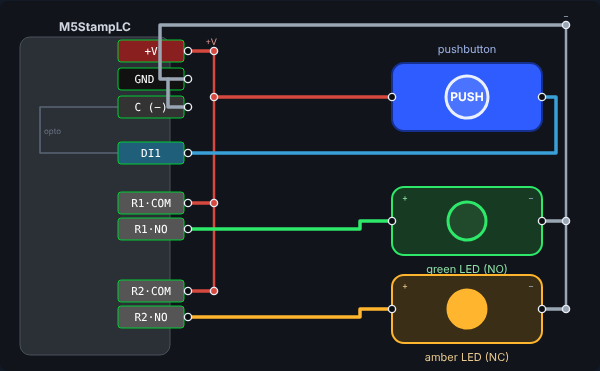
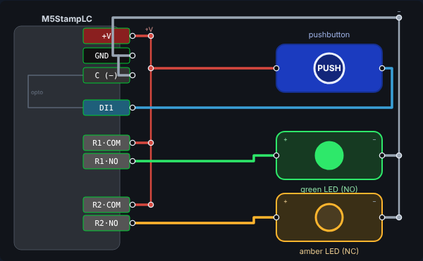

# Test your logic on the running controller — the Studio Test bench

You built a rung in Part 2. Now **drive it** on the running firmware with a simple
virtual circuit — a pushbutton and an LED — and watch your logic move a real output.
No hardware required: everything here runs against the **QEMU twin**, and every step
below was validated on a physical M5StampLC as well (the bench is the reference, not
something you need to own).

> Every readback and result in this section was captured live from the firmware
> console on both the twin and a real StampLC. If your result differs, that's a finding
> — write down what you observed and what you'd check next.



The wiring mirrors a real rig: the **+V** rail feeds the pushbutton and the relay
common (COM); pressing the button energizes **digital input 1 (DI1)**; your ladder
decides what happens; **Relay 1's N.O. contact** switches +V to the **green LED**, and
the LED returns to the **−** rail. The LED lights **only if your ladder connects DI1 to
Relay 1** — so this tests *your logic*, not a hard-wired shortcut.

## Connect the Studio to a controller

Start your twin and the Studio with one command, then open port **8088** and click
**Connect twin**:

```
./qemu/studio.sh          # twin + Studio on http://localhost:8088 (Codespaces: forwarded 8088)
```

The server serves the page and bridges it to your twin on the same origin, so there is
nothing to configure. (Have a real M5StampLC? Open the same Studio on your own machine in
Chrome/Edge, plug in the board, and click **Connect USB** instead — the rest of this section
is identical.)

## A. Build and load the one-rung program

> The twin boots with the **factory motor program** installed (Motor start/stop + E-stop —
> section D). Loading your rung **replaces** it in your twin's flash; you can load the factory
> program back from *Example projects* at any time.

1. In Logic Studio, build one rung: a **normally-open contact on `%IX1`** driving the
   **coil `%QX1`** (Relay 1). (`%IX1` is digital input 1; `%QX1` is Relay 1.)
2. Click **Load application**. Loading requires the controller to be in **PROGRAM**
   mode — the loader refuses a download while running:

   ```
   plc> mode prog
   mode PROGRAM (outputs inhibited, download enabled)
   plc> PLCLOAD …
   [LOADER] OK instr=3 crc=e7ac24c8 scan_ms=50
   [LOADER] applied
   ```
3. Set the controller to **RUN** (`mode run`), and **Start monitoring**.

## B. Test it — press the button

Open **⚡ Test bench → Pushbutton → Green LED** and **press and hold** the button.
Behind the scenes the bench asserts your input (`force IX1 1`); your rung runs; Relay 1
closes; the green LED lights.


**Reconcile with the readback — don't trust the glow.** In the console, `io`:

```
plc> force IX1 1
forced %IX1 = 1
plc> io
DI  : 0 1F 0 0 0 0 0 0
relay commanded/actual (base 0-3):
  relay0 cmd=0 act=0
  relay1 cmd=1 act=1      ← your rung commanded Relay 1 on AND the device reports it on
  relay2 cmd=0 act=0
```

`relay1 cmd/act = 1/1` is your evidence: the logic **commanded** the coil (`cmd=1`)
*and* the device reports the output **actually** on (`act=1`). Relay 0 stays `0/0`,
proving it's *your* DI1→Relay 1 rung running — not some built-in behavior. Release the
button and `relay1` returns to `0/0`.

### Predict → Run → Reconcile

- **Predict.** Before you press: what will `io` report for `relay1` as `cmd/act`?
- **Run.** Press the button; type `io`.
- **Reconcile.** Did `relay1 cmd/act` match your prediction? A match establishes that
  your rung reached the real output image. The LED *looking* on does not — cite the
  readback line in your finding.

## C. Add logic — a second LED, normally-open vs normally-closed

Now extend the program and meet **NO (normally-open)** vs **NC (normally-closed)**
contacts. Add a **second rung**: a **normally-closed contact on `%IX1`** driving
**`%QX2`** (Relay 2). Load it (PROGRAM → Load → RUN) and open **Test bench → Two LEDs —
NO / NC**.

A NO contact passes power when its input is **true** (pressed); a NC contact passes
power when its input is **false** (released). So the two rungs do opposite things from
the *same* button.

| Button | `%IX1` | Rung 1: NO → Relay 1 (green) | Rung 2: NC → Relay 2 (amber) |
|--------|--------|------------------------------|------------------------------|
| released | 0 | off | **on** |
| pressed  | 1 | **on** | off |




Verified readbacks:

```
# released (IX1 = 0)
plc> io
  relay1 cmd=0 act=0        green (NO) off
  relay2 cmd=1 act=1        amber (NC) on

# pressed (force IX1 1)
plc> io
  relay1 cmd=1 act=1        green (NO) on
  relay2 cmd=0 act=0        amber (NC) off
```

### Predict → Run → Reconcile

- **Predict.** With the button **released**, which LED is on — and why? Now flip your
  rung-2 contact from NC to NO and predict again.
- **Run.** Load, RUN, press/release; read `io`.
- **Reconcile.** Explain, in terms of the contact type, which LED followed the button.
  Then: what single rung would make **both** LEDs turn on together?

## D. The factory program — motor start/stop + fail-safe E-stop

The program the factory and twin images ship installed is
[`motor-start-stop-estop.csco`](../web/public/projects/motor-start-stop-estop.csco) (*Example
projects → Motor start/stop + E-stop*). Its tags are what `force` accepts:

| Board terminal (firmware) | Tag | Snap-kit part | 1 means |
|---|---|---|---|
| IN1 (di0) | `start_pb` | press switch, N.O. momentary | pressed |
| IN2 (di1) | `stop_pb` | press switch, N.O. momentary (the kit has no N.C. push button) | pressed |
| IN3 (di2) | `estop_ok` | slide switch wired **N.C.**: ON = healthy | healthy; **0 = tripped or wire cut** |
| IN4 (di3) | `reset_pb` | press switch, N.O. momentary | pressed |
| RELAY 1 (relay0) N.O. | `motor` | snap-kit relay coil → motor on its own battery | running |
| RELAY 2 (relay1) N.O. | `run_light` | green LED | follows the motor |
| RELAY 4 (relay3) N.O. | `fault_lamp` | red LED: the latched E-stop fault | fault latched |

**Start-up state of the predesigned circuit.** Place the E-stop slide switch **ON** (IN3 = 1)
and leave the three push buttons released (IN1, IN2, IN4 = 0). The twin's inputs all read 0 at
boot, so until something drives IN3 the program sees a **tripped E-stop** and, in RUN, latches
the fault lamp — that is the honest reading of an N.C. loop with nothing connected. If the lamp
is already lit, press Reset once. On the console the same start-up is `force estop_ok 1`.

**Predict → Run → Reconcile** (read `io` after each step; predict relay0, relay1, relay3 first):

| Step | Action | Expected relay0 / relay1 / relay3 |
|---|---|---|
| 1 | Start pressed, then released | 1 / 1 / 0 — the motor seals in |
| 2 | Stop pressed | 0 / 0 / 0 |
| 3 | Start again, then E-stop slide OFF (`force estop_ok 0`) | 0 / 0 / **1** — fault latched |
| 4 | E-stop slide back ON | 0 / 0 / **1** — no restart, fault still latched |
| 5 | Reset pressed | 0 / 0 / 0 — fault cleared, motor **stays off** |
| 6 | Start pressed | 1 / 1 / 0 |

Reconcile each row against `io`. Then answer: why must step 4 *not* restart the motor? What
does a cut wire on IN3 do, and what would a cut wire on IN2 (the N.O. Stop) do? `verify-lab.py
P1` asserts exactly these rows.

> Forcing `estop_ok` to 1 defeats the E-stop in software. A real E-stop also opens the motor
> supply directly (a second, hard-wired channel), so no program, force or unauthenticated
> Modbus write can keep the motor running.

## What you can rely on (and what you can't)

- Force the input by its **logical operand**: `force IX1 1` (the Test bench button does
  this for you), or by a **tag name of the loaded program** (`force start_pb 1` with the
  factory program). `force di1` is **not** a valid tag — tags come from the loaded program.
- You must be in **PROGRAM** mode to load a program; **RUN** to execute it.
- An LED only lights if your **ladder** drives its relay. The bench proves your *logic*,
  not your wiring — and `io`'s `cmd/act` is the readback a remote student can cite
  without eyes on the bench.
- **Security beat:** `force` and the Modbus coil write that your trigger rides on have
  **no authentication** (the same CWE-306 path as the E-stop coil). In your finding,
  say what would happen if someone reached that coil without going through the UI.
